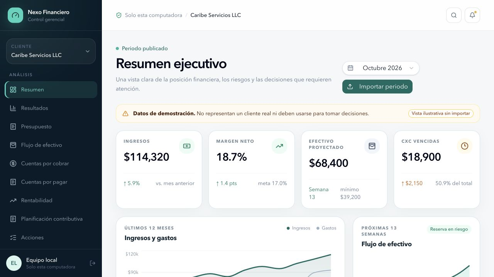
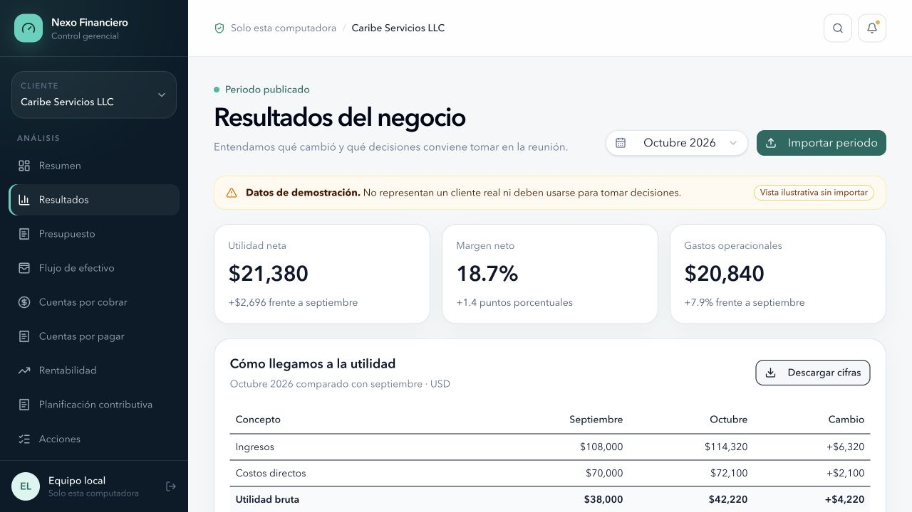
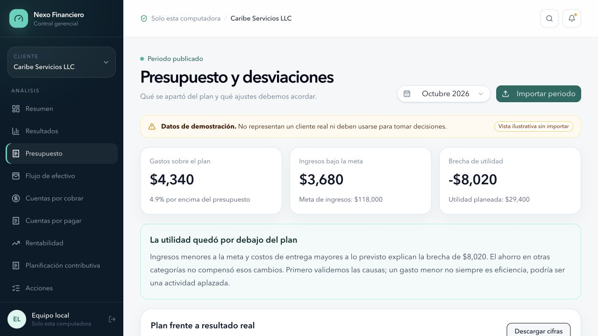
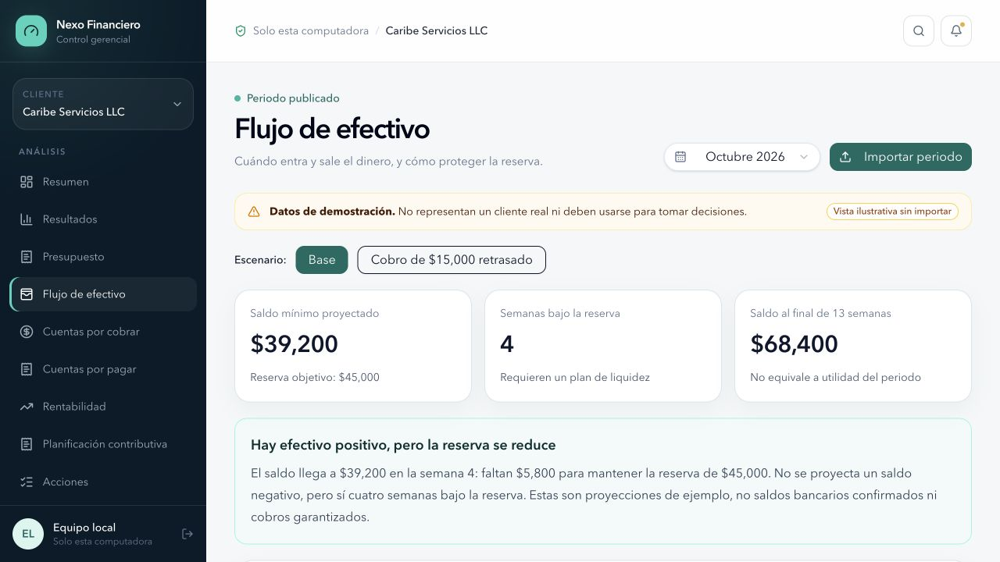
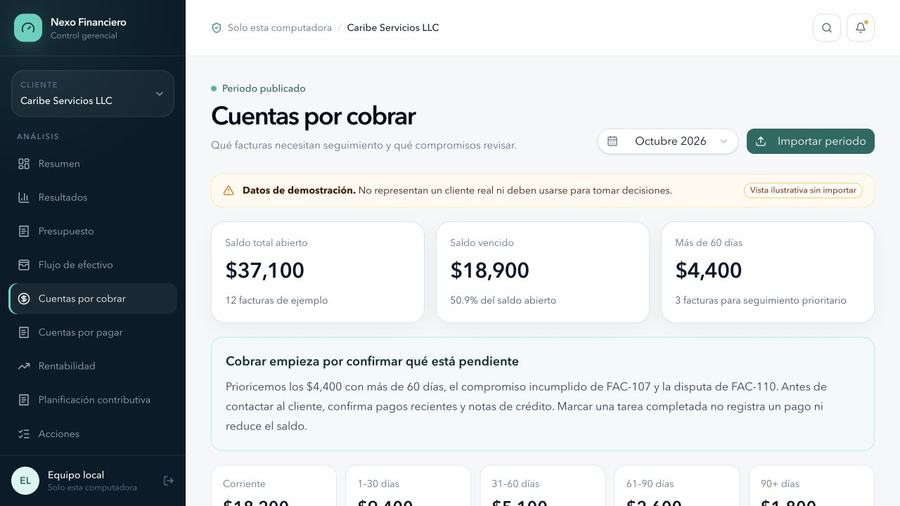
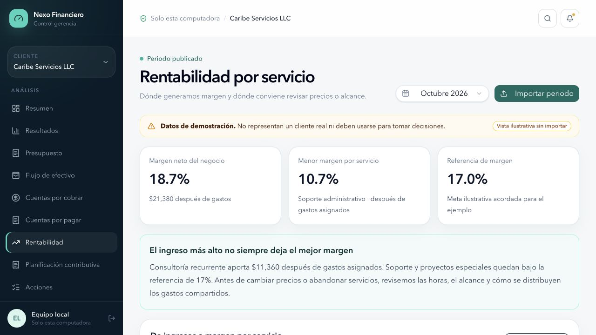
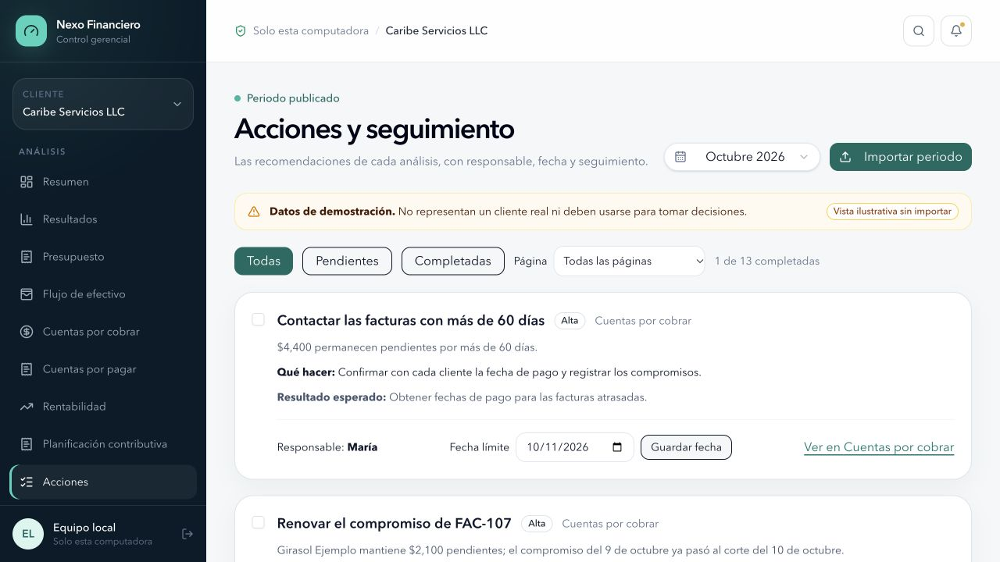

# Nexo Financiero

### Local-first financial management for clearer decisions

Nexo Financiero is a financial operations platform concept designed for small and mid-sized service businesses. It turns accounting data into a practical management workspace for reviewing performance, protecting cash, following up on receivables, understanding profitability, and assigning the next actions.

> **Showcase repository**
> This repository currently contains product documentation and demonstration screenshots only. The application source code and client data are intentionally not included.

## Why it exists

Financial reports often explain what happened without making the next decision obvious. Nexo Financiero connects financial analysis with operational follow-through:

- See the business position at a glance.
- Compare actual results with prior periods and budget.
- Identify cash pressure before it becomes urgent.
- Prioritize collections using aging and follow-up context.
- Understand which services create—or dilute—margin.
- Turn findings into accountable actions with owners and due dates.

The interface is designed in Spanish for Puerto Rico–based financial management workflows. All figures shown below are fictional demonstration data.

## Product tour

### 1. Understand monthly performance

The results workspace explains how revenue, direct costs, operating expenses, and net income changed from the previous month. It highlights material movements and frames the questions that should be discussed in the monthly review.

### 2. Compare the plan with reality

Budget variance analysis separates revenue shortfalls, cost overruns, and favorable variances. Each exception is paired with context and a recommended follow-up instead of being left as an unexplained number.

### 3. Protect near-term liquidity

The 13-week cash view shows projected receipts, payments, ending balances, and weeks that fall below the target reserve. Scenario analysis helps the team discuss timing risk before changing payment or collection plans.

### 4. Focus collection efforts

Accounts receivable are organized by aging bucket, invoice, balance, due date, and collection commitment. This helps the team focus on the highest-priority balances while keeping disputes and missed commitments visible.

### 5. See profitability by service

Service-level analysis bridges revenue to contribution and net margin after allocated operating expenses. A lightweight price simulator supports discussion without changing published figures or approved terms.

### 6. Close the loop with accountable actions

Recommendations from every analysis page flow into one action center. Each item keeps its source, priority, owner, due date, expected outcome, and completion status.

## Core capabilities

| Area | What it helps answer |
| --- | --- |
| Executive overview | What changed, what is at risk, and what needs attention now? |
| Financial results | Why did revenue, costs, margin, and profit move? |
| Budget control | Where did actual performance depart from the approved plan? |
| Cash flow | When could liquidity fall below the operating reserve? |
| Accounts receivable | Which invoices and commitments require follow-up first? |
| Accounts payable | Which obligations require review and payment planning? |
| Profitability | Which services generate sustainable margin? |
| Tax planning | What assumptions, reconciliations, and reviews remain open by jurisdiction? |
| Action tracking | Who owns each decision, and when is it due? |

## Management workflow

1. Import and validate the reporting period locally.
2. Review results, budget variances, and balance-sheet diagnostics.
3. Test cash and profitability scenarios.
4. Discuss findings in the monthly management meeting.
5. Assign actions, owners, and due dates.
6. Track completion and revisit open assumptions in the next cycle.

## Data and privacy principles

Nexo Financiero is designed around a local-first operating model:

- Financial files are processed on the local machine.
- The application and database are intended to listen only on the local interface.
- The workflow does not require a cloud account for daily use.
- Imported data is validated before it is committed.
- Reports and exports are generated locally.
- Demo screens are clearly distinguished from real-data workspaces.

Local-first does not remove the need for appropriate device security, backups, access controls, and professional review. Production deployment should be evaluated against the organization’s own security and compliance requirements.

## Important limitations

- The platform supports management analysis; it is not an accounting system of record.
- Projections and scenarios depend on the completeness and quality of imported data and assumptions.
- Marking an action complete does not post an accounting entry, record a payment, authorize a transaction, or modify the source system.
- Tax-planning views are planning aids, not tax returns, legal opinions, or filing advice.
- Financial conclusions should be reconciled to authoritative records and reviewed by qualified professionals.

## Project status

This repository is a product showcase for the current application concept. The screenshots represent a working local prototype using fictional data. Source code, deployment instructions, credentials, and client datasets are intentionally excluded at this stage.

---

  <strong>Nexo Financiero</strong> 
  Clear financial information. Better management conversations. Accountable next steps.

